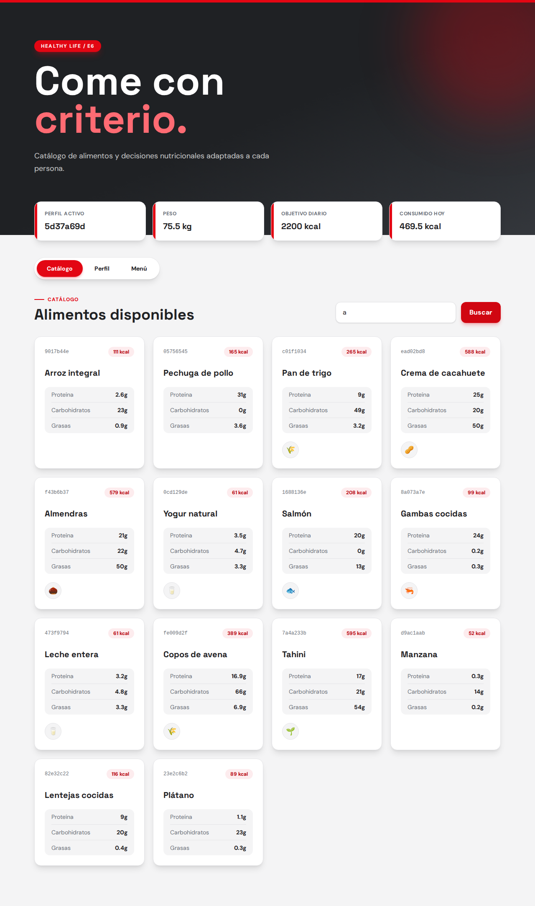
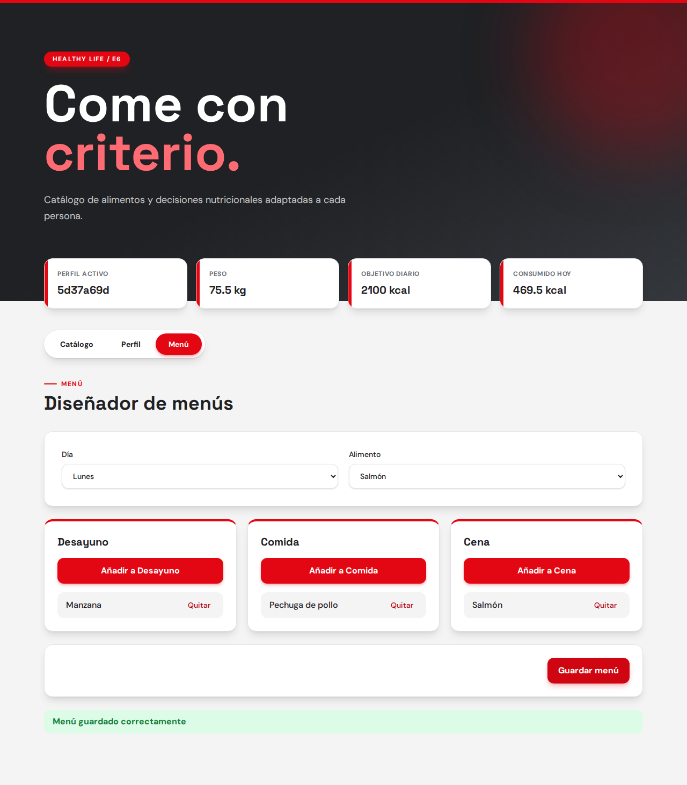

# HexaHealth - Módulo E6: Gestor Nutricional y Catálogo de Alimentos

Proyecto académico de la asignatura **Procesos de Software** · 3.º Grado en Ingeniería del Software · Universidad Rey Juan Carlos

## Equipo 6 (E6)

- **Marcos Vidal Castillo** (Scrum Master - SM)
- **Pablo Villaplana Rodríguez** (Product Owner - PO)
- Paula Sánchez Garduño (Developer)
- Emiliano Sánchez Moreno (Developer)
- David Sebastián Sticea Covaciu (Developer)
- Raúl Tejada Merinero (Developer)
- Rubén Torres Rivero (Developer)
- Alessio Vecchio (Developer)

## Descripción del Módulo

Este repositorio contiene el código correspondiente al Subsistema **E6** de la aplicación global "Healthy Life".

Nuestro módulo se encarga de:

- Gestionar el catálogo de alimentos y sus valores nutricionales (macros).
- Permitir la creación de menús semanales personalizados.
- Aplicar reglas de bloqueo automático de ingredientes prohibidos según el perfil médico/alergias del usuario.
- Generar listas de la compra automatizadas.

## Enlaces de Interés

- **Tablero Miro (Product Discovery & User Story Map):** [Healthy Life en Miro](https://miro.com/welcomeonboard/eC8vdlVYNEhXNmY2MkMwTEhFS2JGZ3lQZHptSWE1YzRXb1JzUlNoKzhkSHZ1SThwQkRJUVpyOXU0eTRQQVdoSUErNXZCM25LcW9wclJuZmZOZjFNb3RBVFhWSDVOTklMREU0R0R6TkUzMTg3cU5taXF2YkJDa3NBM0lMeWJreUNzVXVvMm53MW9OWFg5bkJoVXZxdFhRPT0hdjE=?share_link_id=302909706404)
- **Tablero Jira (Sprint Backlog):** [Healthy Life en Jira](https://procesossoftware.atlassian.net/jira/software/projects/SCRUM/summary?atlOrigin=eyJpIjoiODQ2NjYwOTg5MmE3NDNkZmFhOGUzMjgzYjU3ZGIwNTkiLCJwIjoiaiJ9)
- **Documentación API / Mocks:** en la carpeta [`/mocks`](mocks) de este repositorio.

---

## Stack Tecnológico

- **Frontend:** **React + TypeScript + Vite** (componentes funcionales con tipado estricto) y **TailwindCSS** para los estilos. La interfaz implementa la **Identidad Visual de la URJC con una UI moderna**: rojo corporativo como color `primary` y gris oscuro como `secondary`, tarjetas redondeadas con sombras suaves y transiciones fluidas.
- **Backend:** Node.js con Express (lógica de negocio y API REST).
- **Datos:** en el Sprint 1 se mantienen los ficheros **JSON** de la carpeta `mocks/`. **Datos (más adelante):** **SQLite**, por su persistencia real en archivo y sin necesidad de administrar servidores complejos. La infraestructura (conexión y tablas de usuarios, alimentos y menús) ya está preparada en `backend/src/store/sqliteStore.js`, pero **sin uso activo**: la migración real se hará en el Sprint 2.
- **Tests E2E:** Playwright (carpeta `e2e/`).
- **Control de versiones y despliegue:** Git, GitHub y Docker.
- **Seguridad:** tokens JWT (JSON Web Tokens) en las cabeceras HTTP para la sesión del usuario. **Pendiente (Sprint 2):** en el Sprint 1 no hay autenticación y el frontend usa un usuario de demo.

---

## Despliegue y Ejecución (Docker)

El proyecto está preparado para ejecutarse mediante contenedores Docker.

Para levantar el entorno completo, ejecuta desde la raíz del repositorio:

```bash
docker compose up --build
```

Cuando termine el arranque, estarán disponibles:

- **Frontend:** http://localhost:5173
- **API:** http://localhost:3000/api/health

Para detenerlo, `docker compose down` (lo que se haya guardado en `mocks/` se conserva).

### Estructura principal

```text
backend/
    src/server.js          # arranque (listen)
    src/app.js             # Express: middlewares, rutas y errores
    src/routes/            # food, user, nutrition, menu
    src/controllers/       # reciben la petición, llaman al servicio y responden
    src/services/          # reglas de negocio (usuarios, alimentos, menús, nutrición)
    src/store/jsonStore.js # lectura/escritura de los mocks JSON (en uso)
    src/store/sqliteStore.js # SQLite: conexión y tablas (preparado, sin uso en el Sprint 1)
    Dockerfile
    package.json
frontend/
    src/App.tsx
    src/api.ts
    src/types/index.ts     # interfaces del dominio (Food, UserProfile, Menu...)
    src/components/        # SearchBar, FoodList, FoodItem, ProfileEditor, MenuBuilder...
    src/main.tsx
    src/styles.css         # Tailwind + paleta URJC (primary / secondary)
    tsconfig.json
    vite.config.js
    Dockerfile
    nginx.conf
e2e/                       # tests Playwright (3 ficheros, 6 tests, uno por criterio de aceptación)
mocks/
    mock_usuarios.json
    mock_alimentos.json
    mock_alergenos.json
    mock_consumo.json
    mock_menus.json
docker-compose.yml
```

El backend escribe en los ficheros de `mocks/` (perfil y menús), por eso `docker-compose.yml` monta esa carpeta como volumen.

### Desarrollo local y tests E2E

Requisitos: **Node.js 22 o superior** (lo exige `better-sqlite3`) y **Docker** para el despliegue.

```bash
cd backend && npm install && npm run dev    # API en :3000
cd frontend && npm install && npm run dev   # Front en :5173
cd frontend && npm run typecheck            # comprobación de tipos (TypeScript)
cd frontend && npm run build                # tipos + compilación de producción

cd e2e && npm install && npm run install:browsers   # solo la primera vez
cd e2e && npm test                            # batería E2E (6 tests)
cd e2e && npx playwright test tests/menu.spec.js   # un solo fichero
cd e2e && npm run test:ui                     # interfaz visual de Playwright
cd e2e && npx playwright show-report          # informe HTML de la última ejecución
cd e2e && npm run screenshots                 # regenera docs/assets/*.png
```

Los tests arrancan su propio backend (:3100) sobre una copia temporal de `mocks/` y el frontend (:5174), así que no modifican los datos del repositorio ni necesitan Docker.

> **Sobre la batería de tests:** se ha creado para facilitar la **validación de los criterios de aceptación** (Dado/Cuando/Entonces) de cada Historia de Usuario. Hay 6 tests repartidos en 3 ficheros de `e2e/tests` y cada test está nombrado con su criterio (por ejemplo, `HU 1.1 › AC2`), con los pasos comentados con las mismas palabras "Dado / Cuando / Entonces" de la historia. Así, comprobar que una historia cumple lo acordado con el PO es ejecutar `npm test` y ver qué criterios pasan o fallan. Qué hace y qué comprueba cada test, uno a uno, está explicado en [docs/sprint1-readme.md](docs/sprint1-readme.md#tests-e2e-qué-comprueba-cada-uno).

---

## Arquitectura de Integración y Contratos (API REST)

El acuerdo de interfaces no es solo interno: es la negociación con los otros equipos de la clase (por ejemplo, con el equipo **E1**, que hace los usuarios, o el **E2**, que hace las gráficas). Sirve para decidir cómo se van a comunicar los servidores en el futuro para que nadie programe a ciegas.

El Módulo E6 se comunica con el resto del ecosistema Healthy Life mediante una arquitectura orientada a microservicios simulada vía **API REST**, utilizando **JSON** como formato de intercambio de datos.

### Dependencias entrantes (lo que E6 necesita leer)

**Perfil nutricional y alergias — dependencia de E1 (Gestión de Usuarios)**

Para la validación estricta de restricciones médicas y el cálculo de menús, E6 consume los perfiles gestionados por el módulo de identidades.

- **Endpoint esperado:** `GET /api/users/{userId}/nutritional-profile`
- **Payload requerido:**

  ```json
  {
    "userId": "string",
    "weight": "number",
    "caloricGoal": "number",
    "medicalRestrictions": {
      "allergies": ["string"],
      "dietType": "string"
    }
  }
  ```

- **Estado Sprint 1:** aislado y resuelto mediante simulación local. Para evitar bloqueos, la respuesta de este endpoint está mockeada en [`/mocks/mock_usuarios.json`](mocks/mock_usuarios.json).

### Servicios expuestos (lo que E6 ofrece al resto)

**Telemetría nutricional — consumido por E2 (Seguimiento de Hábitos) y E5 (Entrenamiento)**

Para alimentar el dashboard analítico y de seguimiento de hábitos, E6 presenta el consumo calórico en tiempo real: calorías totales consumidas en el día actual y desglose de macronutrientes listos para ser graficados

- **Endpoint expuesto:** `GET /api/nutrition/{userId}/daily-summary`
- **Respuesta proporcionada:**

  ```json
  {
    "userId": "string",
    "date": "YYYY-MM-DD",
    "totalCaloriesConsumed": "number",
    "macros": {
      "protein": "number",
      "carbs": "number",
      "fats": "number"
    }
  }
  ```

### Endpoints internos de E6 (Sprint 1)

| Método | Ruta                                      | Descripción                                                                                                                                     |
| ------ | ----------------------------------------- | ----------------------------------------------------------------------------------------------------------------------------------------------- |
| GET    | `/api/foods?search=`                      | Catálogo de alimentos, con búsqueda por nombre (sin distinguir mayúsculas ni tildes)                                                            |
| GET    | `/api/allergens`                          | Catálogo de alérgenos (id, nombre, icono y explicación)                                                                                         |
| PUT    | `/api/users/{userId}/nutritional-profile` | Actualiza el objetivo calórico diario (`caloricGoal`) (escribe en `mock_usuarios.json`)                                                         |
| GET    | `/api/menus/{userId}`                     | Menú del usuario (vacío si aún no tiene)                                                                                                        |
| PUT    | `/api/menus/{userId}`                     | Guarda el menú `{ days: { lunes: { desayuno: [foodId], comida: [], cena: [] }, ... } }`                                                        |

---

## Estándares de Desarrollo Interno (leer antes de hacer push)

1. **Tipado de IDs:** utilizar siempre formato **UUID v4** (ej. `"f47ac10b-58cc-4372-a567-0e02b2c3d479"`) para todos los identificadores (usuarios, alimentos, menús). Evita colisiones entre módulos.
2. **Tratamiento de alérgenos:** el motor de reglas compara strings en **español, minúsculas, sin tildes ni espacios** (ej. `"gluten"`, `"frutos_secos"`).
3. **Respuestas HTTP y errores:** todo endpoint devuelve un JSON válido. En caso de error, la respuesta estándar es:

   ```json
   { "error": true, "code": 404, "message": "Descripción del problema" }
   ```

4. **Bloqueo por mock (Sprint 1):** no hacer peticiones `fetch`/`axios` reales a las URLs de otros equipos. Leer directamente del archivo local `mocks/mock_usuarios.json`.

---

## Estado del Sprint 1 (MVP)

En este primer Sprint se han implementado las siguientes funcionalidades principales (Historias de Usuario):

- **[HU 1.1]** Búsqueda de alimentos y macros.
- **[HU 1.2]** Visualización de iconos de alérgenos en el catálogo.
- **[HU 2.1]** Fijar el objetivo calórico diario en el perfil nutricional.
- **[HU 3.1]** Creación básica de menú (Desayuno, Comida y Cena por día).

Los criterios de aceptación de las cuatro historias están cubiertos por los tests E2E de la carpeta `e2e/tests`.

### Aspecto final de la interfaz

Interfaz con la identidad visual de la URJC (rojo corporativo y gris oscuro). Las capturas se generan con `cd e2e && npm run screenshots` (ver `e2e/tests/screenshots.spec.ts`).

**Catálogo** — búsqueda por nombre, macros e iconos de alérgenos:



**Perfil** — objetivo calórico diario:


**Menú** — diseñador de menús con Desayuno, Comida y Cena:



### Historias de Usuario del Sprint 1

| Jira                                                               | Historia                                 | Puntos | Qué permite                                          |
| ------------------------------------------------------------------ | ---------------------------------------- | ------ | ---------------------------------------------------- |
| [SCRUM-21](https://procesossoftware.atlassian.net/browse/SCRUM-21) | HU 1.1 Buscar un alimento                | 3      | Buscar en el catálogo y ver calorías y macros        |
| [SCRUM-27](https://procesossoftware.atlassian.net/browse/SCRUM-27) | HU 1.2 Ver iconos de alérgenos           | 2      | Ver iconos de alérgenos y su explicación             |
| [SCRUM-17](https://procesossoftware.atlassian.net/browse/SCRUM-17) | HU 2.1 Fijar objetivo calórico diario   | 3      | Configurar el objetivo calórico en el perfil         |
| [SCRUM-34](https://procesossoftware.atlassian.net/browse/SCRUM-34) | HU 3.1 Creación de menús                 | 5      | Diseñar el menú con Desayuno, Comida y Cena          |

> **Más información:** criterios de aceptación, endpoints, componentes, orden de los PR, cómo revisar y probar cada rama y estado de la Definition of Done en [docs/sprint1-readme.md](docs/sprint1-readme.md).
