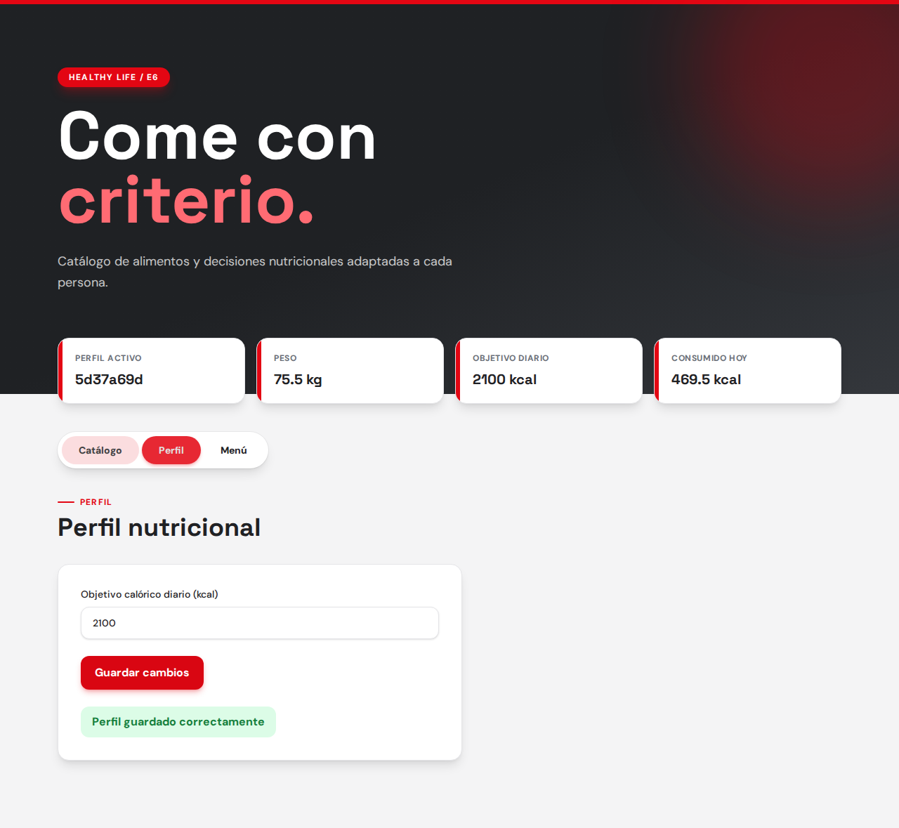
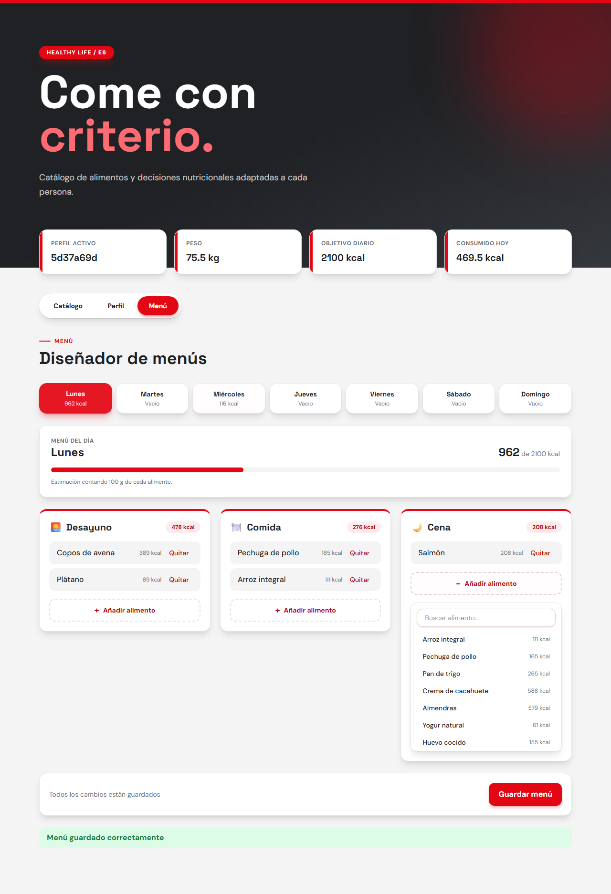

# Sprint 1 · Módulo E6 (Gestor Nutricional)

MVP de 13 puntos, entregado. Visión general y cómo ejecutarlo en el [README principal](../README.md).

## Roles

- **Product Owner:** Pablo Villaplana Rodríguez
- **Scrum Master:** Marcos Vidal Castillo
- **Developers:** Paula Sánchez Garduño, Emiliano Sánchez Moreno, David Sebastián Sticea Covaciu, Raúl Tejada Merinero, Rubén Torres Rivero, Alessio Vecchio

## Historias implementadas

- HU 1.1 Buscar un alimento y ver sus macros (SCRUM-21) · `catalogo.spec.js`
- HU 1.2 Ver iconos de alérgenos (SCRUM-27) · `catalogo.spec.js`
- HU 2.1 Fijar objetivo calórico diario (SCRUM-17) · `perfil.spec.js`
- HU 3.1 Crear un menú básico (SCRUM-34) · `menu.spec.js`

Tests E2E: 6 en verde.

## Interfaz

Capturas generadas con `cd e2e && npm run screenshots`.

**Catálogo** — búsqueda por nombre, macros e iconos de alérgenos:

**Perfil** — objetivo calórico diario:

**Menú** — diseñador de menús con Desayuno, Comida y Cena:

