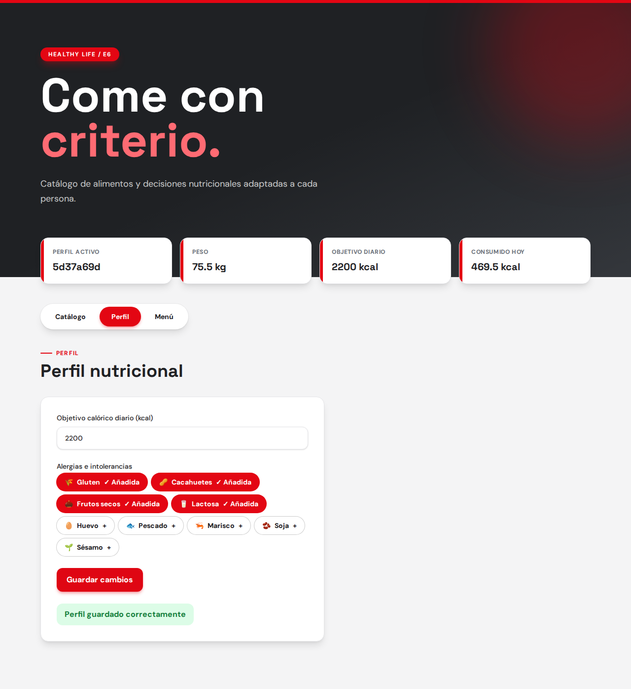
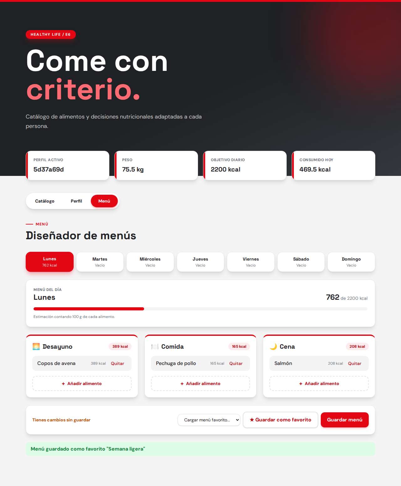

# Sprint 2 · Módulo E6 (Gestor Nutricional)

20 oct – 10 nov · 17 puntos. Visión general y cómo ejecutarlo en el [README principal](../README.md).

## Roles

- **Product Owner:** Rubén Torres
- **Scrum Master:** Emiliano Sánchez
- **Developers:** Paula, Marcos, David, Raúl, Pablo y Alessio

## Sprint Goal

Garantizar la seguridad clínica del usuario automatizando el bloqueo de alimentos incompatibles con sus alergias o dieta, y dotar al diseñador de menús de cálculo inteligente y opciones de guardado.

## Historias

- HU 2.2 Indicar alérgenos e intolerancias (SCRUM-26) · `perfil.spec.js`
- HU 2.3 Introducir preferencias dietéticas (SCRUM-35)
- HU 3.2 Sumar calorías del menú automáticamente (SCRUM-20)
- HU 3.3 Guardar menú favorito (SCRUM-23) · `menu.spec.js`
- HU 3.4 Motor de reglas para bloquear alimentos peligrosos (SCRUM-24)
- HU 1.3 Añadir nuevos alimentos al catálogo (SCRUM-28)

Tests E2E hasta ahora: 4 en verde (HU 2.2: 3, HU 3.3: 1).

El estado de cada una está en el [tablero de Jira](https://procesossoftware.atlassian.net/jira/software/projects/SCRUM/summary).

## Interfaz

Capturas en [`assets/sprint2/`](assets/sprint2), generadas con `cd e2e && npm run screenshots`.

**HU 2.2 · Alergias en el perfil**

**HU 3.3 · Menú favorito**

**HU 2.3 · Preferencias dietéticas** — _pendiente_

**HU 3.2 · Calorías del menú** — _pendiente_

**HU 3.4 · Motor de reglas** — _pendiente_

**HU 1.3 · Añadir alimentos** — _pendiente_
